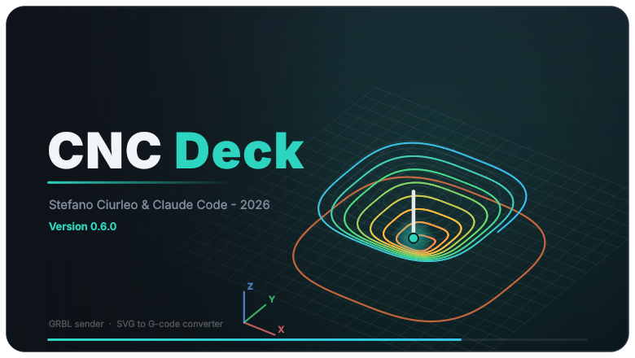
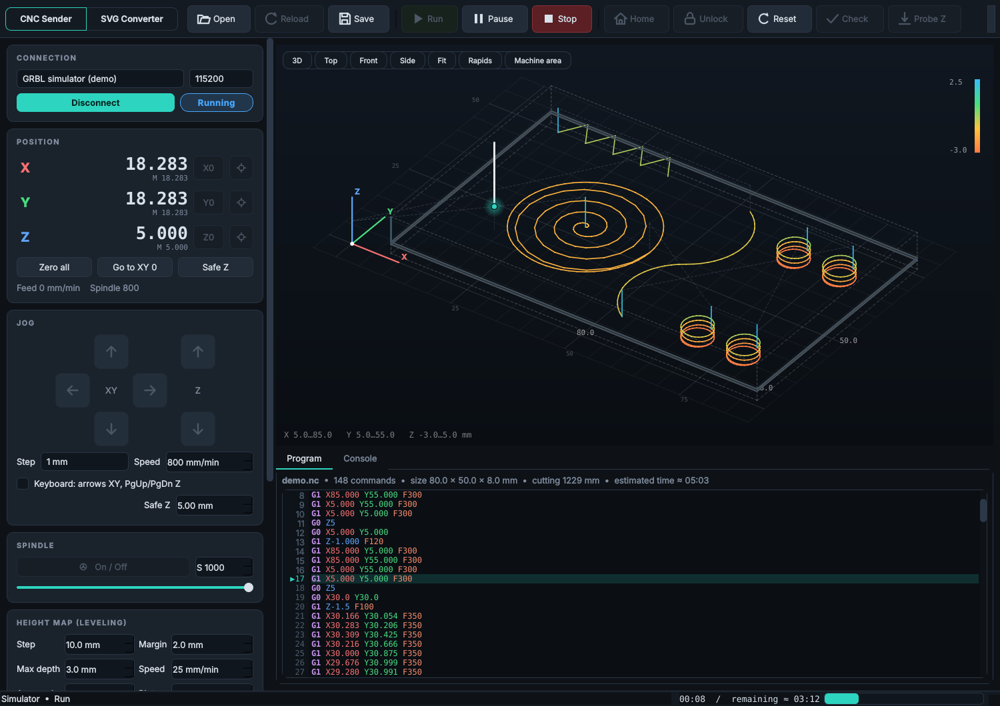
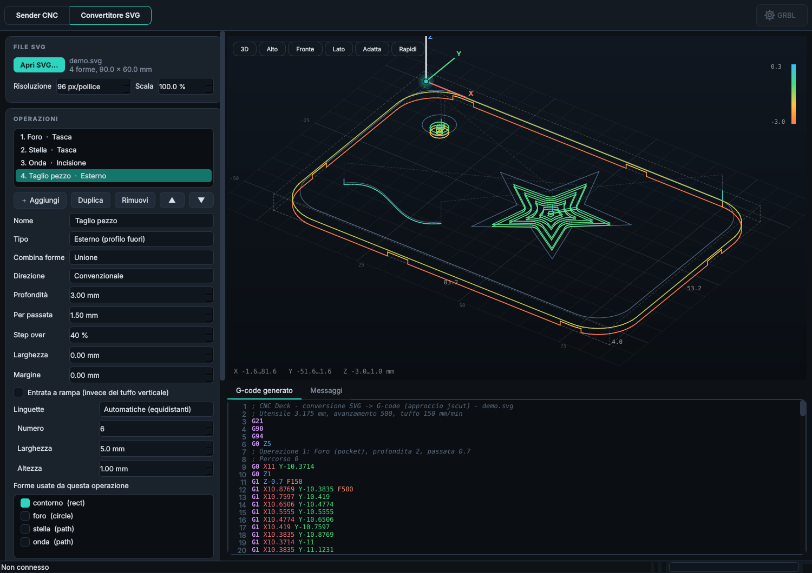

# CNC Deck

<p align="center"></p>

Sender G-code per CNC **GRBL 1.1** (pensato per la CNC 1610 Pro) con interfaccia scura e viewer 3D, più un convertitore **SVG → G-code**.
Python 3 + Qt6 (PySide6) + pyserial. Testato su Ubuntu 26.04 LTS.

## Com'è fatto

Un'unica finestra con due modalità, selezionabili dall'interruttore in alto a sinistra.

**Sender CNC** – carica un `.gcode`, controlla la macchina (DRO, jog, probe Z, override, mandrino) e invia il programma con anteprima 3D in tempo reale. Qui il lavoro di esempio è in esecuzione sul simulatore GRBL integrato.

<p align="center"></p>

**Convertitore SVG** – carica un `.svg`, crea una o più operazioni (esterno, interno, tasca, incisione, con linguette di fissaggio), guarda il percorso utensile in anteprima 3D e poi salva il `.gcode` o premi **Invia alla CNC** per caricarlo direttamente nel Sender.

<p align="center"></p>

## Installazione (Ubuntu)

```bash
./install.sh          # venv in ~/.local/share/cncdeck, launcher "cncdeck", voce nel menu
cncdeck               # oppure: cncdeck examples/demo.nc
cncdeck --sim         # prova tutto senza macchina (simulatore GRBL interno)
cncdeck --no-splash   # senza la schermata iniziale di 3 secondi (o CNCDECK_NO_SPLASH=1)
```

Senza installare: `pip install -r requirements.txt && python3 -m cncdeck`.

## Installazione come pacchetto .deb (Ubuntu/Debian)

Pacchetto "da distribuzione": contiene solo CNC Deck e usa le librerie Python di sistema (`python3-pyside6.*`, `python3-numpy`,
`python3-serial`, `python3-pyclipper`); incorpora soltanto `svgelements`. Si installa e si disinstalla con apt o Synaptic:

```bash
sudo apt install ./packaging/deb/cncdeck_0.6.0_all.deb     # installa anche le dipendenze di sistema
sudo apt remove cncdeck                                    # disinstalla (oppure da Synaptic / Software)
```

- Richiede che nei repository della tua versione di Ubuntu ci siano i pacchetti `python3-pyside6.*` e `python3-pyclipper`
  (verifica: `apt-cache policy python3-pyside6.qtwidgets python3-pyclipper`). Se mancano, usa `./install.sh`.
- Porta seriale: `sudo usermod -aG dialout $USER` (poi logout/login); vedi anche `/usr/share/doc/cncdeck/README.Debian`.
- Se avevi installato con `install.sh`, rimuovi prima quella copia (vedi README.Debian) per non avere due versioni.
- Per rigenerare il pacchetto: `packaging/build-deb.sh` (richiede `dpkg-deb` e pip; scrive in `dist/`).


**Porta seriale su Ubuntu** (cause classiche di "non vedo la porta"):
- l'utente deve stare nel gruppo `dialout`: `sudo usermod -aG dialout $USER`, poi logout/login;
- `brltty` ruba le schede CH340 (la 1610 Pro ne usa una): `sudo apt remove brltty`.

## Funzioni

| | |
|---|---|
| Streaming | protocollo *character-counting* (buffer RX 127 byte), senza pause tra le righe; pausa = feed hold `!`, stop = hold + soft reset (la posizione resta valida) |
| Viewer 3D | orbita (sx), pan (dx/centrale), zoom (rotella), doppio clic = inquadra; colore per quota Z, rapidi tratteggiati, parte già eseguita in grigio, utensile in tempo reale, ingombro, area macchina ($130-132) |
| Programma | editor con evidenziazione, riga in esecuzione, stima del tempo (anche residuo, corretta per l'override), avvisi (G1 senza F, righe > 80 caratteri, G-code non supportati, corsa superata) |
| Riprendi | tasto destro su una riga → *Avvia da riga…* ripristina unità/avanzamento/mandrino, sale, va in XY e scende |
| DRO | coordinate di lavoro e macchina, azzeramento per asse (`G10 L20 P0`, persistente), vai a zero, Z sicura |
| Jog | passo 0.01–50 mm o continuo (si ferma subito al rilascio con jog-cancel), tastiera opzionale (frecce, Pag↑/↓) |
| Probe Z | discesa lenta `G38.2` su piastrina di tocco, azzera Z con lo spessore indicato e risale |
| Mappa altezze | livellamento automatico: tasta con la sonda una griglia sull'area del G-code e corregge la Z di ogni movimento prima dell'invio. Vedi sotto |
| Override | avanzamento, rapidi, mandrino (comandi real-time) |
| Mandrino | M3/M5 con S regolabile |
| Convertitore SVG | modalità «Convertitore SVG» (interruttore in alto a sinistra): carica un `.svg`, scegli operazioni e utensile, anteprima 3D live, **Salva .gcode** oppure **Invia alla CNC ➜** (carica il G-code nel Sender senza passare dal disco). Vedi sotto |
| Altro | homing, sblocco, reset, check mode, console con cronologia, editor dei `$$` con descrizioni, 6 macro personalizzabili, drag & drop del file, M6/T convertiti in pausa M0 per il cambio utensile manuale |

## Convertitore SVG → G-code

Approccio di [jscut](https://github.com/tbfleming/jscut), riscritto in Python con `pyclipper` (binding di Clipper, la
stessa libreria geometrica di jscut) e `svgelements` (trasformazioni, unità, viewBox):

- **Operazioni** (si parte con la lista vuota, come in jscut: le crei tu con «＋ Aggiungi»; anche più d'una, in sequenza): *Esterno*, *Interno*, *Tasca*, *Incisione* (linea centrale, anche tracciati aperti);
  per ognuna: forme usate, combinazione (unione / intersezione / differenza / XOR), direzione (convenzionale / concorde, per mandrino
  orario), profondità totale e per passata, step over, larghezza della fascia, margine, entrata a rampa.
- **Utensile**: diametro, avanzamento di taglio e di tuffo, Z di sicurezza, M3/M5 opzionali, unità del G-code (mm o pollici), posizione dello zero.
- **Convenzione Y come jscut**: Y_gcode = −Y_svg. Con «angolo alto-sinistro del disegno» (predefinito) lo zero sta in alto a sinistra del
  pezzo e il lavoro si sviluppa in Y negativa, esattamente come i file che già usi. Il tuo zero pezzo deve coincidere con quel punto.
- **Ottimizzazioni rispetto all'output jscut**: spostamenti con `G0` (non `G1` con feed enormi), nessun punto duplicato o allineato,
  avanzamento scritto solo quando cambia, righe corte, intestazione `G21 G90 G94`, fine con `G0` a Z sicura e `M2`. Il G-code generato
  passa dallo stesso parser e dallo stesso streaming del Sender: un test lo trasmette al simulatore GRBL senza errori.
- Il mandrino **non** viene acceso di default (come jscut): usa il pulsante Mandrino del Sender oppure attiva M3/M5 nel convertitore.
- «Invia alla CNC» **non avvia** il lavoro: porta il programma nel Sender e passa a quella modalità; controlla lo zero e premi Avvia.

- **Linguette di fissaggio** (solo Esterno/Interno): lungo il taglio la fresa resta a `Altezza` mm dal fondo, così il pezzo non si stacca
  né si muove. *Automatiche*: N linguette equidistanti sul contorno di ogni pezzo (i fori non ne hanno). *Da forme SVG*: disegna un
  piccolo cerchio/rettangolo a cavallo del bordo e marcalo come linguetta; la forma non viene fresata e copre il percorso a un
  raggio utensile da lei. Richiedono una sola passata laterale (larghezza = diametro utensile) e un'altezza minore della profondità.

Non implementati rispetto a jscut: *V-pocket*, Z origin dal fondo del materiale, conversione da testo SVG (converti in tracciati).

Non implementato (rispetto a Candle): **height map / autolivellamento**. Il viewer assume programmi in coordinate
assolute (G90) che partono dallo zero pezzo; un programma solo-G91 viene disegnato a partire da 0,0,0.

## Mappa altezze (livellamento con la sonda)

Solo nel Sender. GRBL 1.1 non compensa la planarità, quindi lo fa CNC Deck: misura la superficie e corregge il G-code prima di inviarlo
(il file originale non viene modificato).

1. Carica il G-code. Spegni il mandrino, collega la pinza della sonda alla fresa e al materiale (rame/metallo), azzera X, Y e Z
   **sulla superficie nell'origine del lavoro** e solleva la fresa. Se il materiale non conduce, appoggia una piastrina e indica lo spessore.
2. Scheda **Mappa altezze** → *Tasta area del lavoro*: la griglia copre l'ingombro delle sole lavorazioni più il margine, con passo ≤ al valore scelto.
   Ogni punto: sale a Z sicura, si sposta, scende veloce fino a *Avvicin.* sopra l'ultimo contatto e poi tasta lentamente (`G38.2`).
   La prima discesa parte da Z sicura. Il tasto *Annulla* (o Stop) interrompe; nessun contatto entro *Prof. max*, un allarme o un errore fermano tutto.
3. La mappa si vede nel viewer (rilievo esagerato, colori per quota). Con «Applica la mappa» spuntato, *Avvia* e *Avvia da riga…* inviano
   il G-code corretto: ogni taglio è spezzato a ogni linea della griglia e a ogni punto si somma l'altezza della superficie (interpolazione bilineare).
   Gli archi diventano segmenti `G1`; i rapidi correggono solo la quota di arrivo. Si può salvare/caricare la mappa (`.json`).

Limiti e cautele:
- La mappa è in coordinate **macchina**: resta valida se cambi lo zero pezzo, ma **non** se sposti il pezzo o il piano.
- Programmi con `G92`, `G10`, `G55`–`G59` sono rifiutati (cambierebbero il sistema di coordinate); dopo `G28/G30/G53` servono movimenti assoluti.
- Fuori dall'area mappata si usa l'altezza del bordo (te lo segnala prima di partire).
- Precisione: quella della tua sonda e di GRBL (tipicamente 0,01–0,03 mm a 25 mm/min). Per fresature profonde serve a poco; per incisioni/PCB sì.
- Tempi: griglia da 10 mm su 150×90 mm ≈ 150 punti, 10–15 minuti. Il tasto *Tasta* mostra la stima.
- Collaudato solo sul simulatore (piano inclinato): **prova la prima volta su scarto, a mandrino spento.**

## Sviluppo

```bash
pip install -e .[dev]
python -m pytest            # test: parser, protocollo/streaming contro il simulatore, conversione SVG/CAM, UI offscreen
python examples/make_demo.py
QT_QPA_PLATFORM=offscreen python3 docs/make_screenshots.py   # rigenera le immagini del README
```

`cncdeck/simulator.py` emula GRBL 1.1 (buffer RX da 127 byte, planner da 15 blocchi, hold/jog-cancel, WCO, probe,
override) ed è usato sia dalla modalità `--sim` sia dai test: i test verificano che lo streaming non superi
mai il buffer RX.

**Importante**: i test girano sul simulatore; il comportamento sulla scheda reale va verificato con cautela
(prima un giro a vuoto, o *Check mode*, senza fresa e con la mano sull'emergenza).
